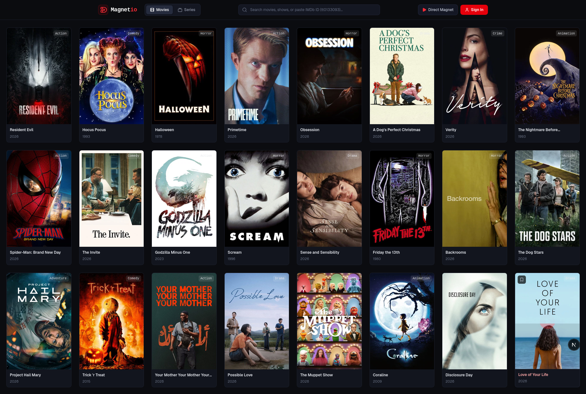

<p align="center">
  
</p>

<h1 align="center">Magnetio</h1>

<p align="center">Magnetio is a lightweight, peer-to-peer web media streaming platform for movies and TV series. It resolves torrent streams via Torrentio and streams video directly to the browser.</p>

<p align="center">
  
</p>

---

## Project Structure

```text
Magnetio/
├── backend/   # Hono API + WebTorrent sequential streaming engine (Node.js runtime)
├── frontend/  # Next.js 16 web client + HTML5 streaming player (Tailwind CSS)
├── docker/    # backend.Dockerfile & frontend.Dockerfile
└── docker-compose.yml
```

---

## Prerequisites

- **Node.js 20.9+** (Node 22 recommended) — required to run `tsx`, `@hono/node-server`, and WebTorrent, which need Node's runtime/network stack.
- **Bun** 1.3+ — used as the package manager in both apps.

---

## Setup

### Env variables

```bash
bun run backend:env && bun run frontend:env
# Fill up the .env files
```

### Running Everything at once

```bash
bun install:all
bun run dev
```

Then open **`http://localhost:3001`** in the browser

### Running the Backend only

```bash
bun run backend:dev
# Backend API runs at http://localhost:3000
```

### Running the Frontend only

```bash
bun run frontend:dev
# Frontend web UI runs at http://localhost:3001
```

---

## Code Quality

Tooling lives at the repo root because `frontend/` and `backend/` share one git repo. Install the root dependencies once (this also registers the git hooks):

| Command                | What it does                             |
| ---------------------- | ---------------------------------------- |
| `bun run format`       | Prettier write across both apps          |
| `bun run format:check` | Verify formatting without changing files |
| `bun run lint`         | ESLint in both apps                      |
| `bun run typecheck`    | `tsc --noEmit` in both apps              |

---

## Run with Docker

```bash
# Run
sudo docker compose up -d --build

#  Stop
sudo docker compose down
```

- Backend exposed on **`3000:3000`**
- Frontend exposed on **`3001:3001`**

---

## Disclaimer

This project is created for educational and self-hosting purposes. Users are responsible for complying with applicable laws regarding content accessed via BitTorrent.
